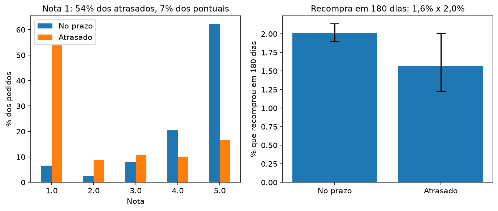
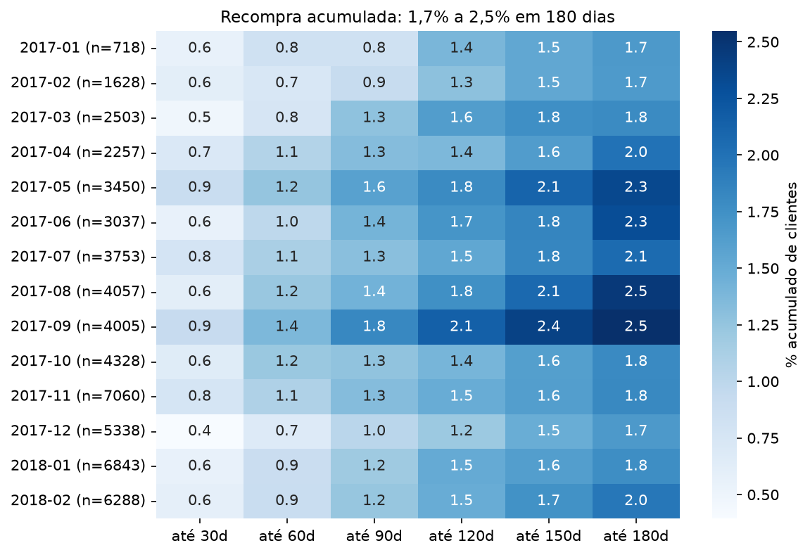

# Olist: o atraso na entrega faz o cliente não voltar?

Análise de 96 mil pedidos de um marketplace brasileiro (Olist, 2017-2018)
para entender se entregas atrasadas pioram a satisfação e reduzem a
recompra. Feita em Python.

**Resposta curta:** o atraso piora muito a nota do pedido, mas explica pouco
do motivo de poucos clientes voltarem a comprar.

## A pergunta

Poucos clientes compram mais de uma vez no Olist. Uma explicação comum é que
entregas atrasadas afastam o cliente. Duas hipóteses foram testadas:

1. Pedidos atrasados recebem notas menores.
2. Clientes cujo primeiro pedido atrasou recompram menos.

A decisão por trás: vale investir em logística para aumentar a retenção?

## O que os dados mostram

| | Atrasados | No prazo | Diferença |
| --- | --- | --- | --- |
| **Notas 1 ou 2** | 62,4% | 9,2% | +53,2 pontos percentuais (IC 95%: +52,0 a +54,4) |
| **Nota média** | 2,27 | 4,29 | |
| **Recompra em 180 dias** | 1,57% (62 de 3.958 clientes) | 2,01% (1.050 de 52.234) | -0,44 pontos percentuais (IC 95%: -0,83 a -0,01) |

- **Satisfação: muito afetada.** Entre os pedidos atrasados, 62% recebem nota
  1 ou 2, contra 9% dos entregues no prazo. Ao comparar um pedido pontual com
  um atrasado, o pontual tem nota maior em 82% das vezes (empates contados
  pela metade).
- **Recompra: queda pequena e incerta.** Clientes com primeiro pedido
  atrasado recompram menos (1,6% contra 2,0%), mas só 62 deles recompraram, e
  a amostra é pequena demais para ter certeza do tamanho do efeito.
- **Em número de clientes:** se os atrasados recomprassem como os pontuais,
  seriam cerca de 18 recompradores a mais, 1,6% sobre os 1.112 da base.
- **A recompra é baixa em todo lugar:** menos de 3% dos clientes voltam a
  comprar em 180 dias, em todas as coortes.

## Figuras



*Esquerda: distribuição das notas, por pontualidade da entrega. Direita: taxa
de recompra em 180 dias, com o intervalo de 95% de cada grupo. A conclusão
se apoia no intervalo da diferença (-0,83 a -0,01 pontos percentuais), não
na sobreposição das barras.*



*Percentual acumulado de clientes que recompraram até 30, 60, ..., 180 dias,
por mês do primeiro pedido (n = clientes da coorte). Em 180 dias a taxa fica
entre 1,7% e 2,5%; as diferenças entre coortes são do tamanho do ruído da
amostra.*

## Conclusão

O atraso afeta muito a satisfação e pouco a recompra. Melhorar a entrega faz
sentido pela experiência do cliente, já que a nota despenca, mas esta análise
não sustenta apresentá-la como solução para a baixa retenção: a recompra é
baixa em todos os grupos, e o atraso explica só uma parte pequena disso. O
que mantém a recompra baixa precisa ser investigado em outros fatores.

Como os dados são observacionais, de um único marketplace e de uma janela
curta, o resultado da recompra deve ser lido como um indício, não como
prova.

## Recomendações

1. **Não justificar investimento em logística só por retenção.** O efeito na
   recompra é pequeno (cerca de 0,4 ponto percentual). O argumento para
   melhorar a entrega está na satisfação dos clientes.
2. **Testar um cupom para clientes com atraso, em um teste A/B.** O dataset
   não permite avaliar isso (não há campanha nem grupo de controle). Como o
   efeito esperado é pequeno, calcular o tamanho da amostra antes de rodar.
3. **Investigar outras explicações para a baixa recompra**, como aquisição,
   tipo de produto e frete, que esta análise não cobre.

## Limitações

- **Associação, não causa.** Pedidos atrasados também podem diferir por
  região, produto e vendedor.
- **Poucos recompradores entre os atrasados.** Com só 62, o intervalo é largo.
  Além disso, a diferença observada (0,44 ponto percentual) é menor do que o
  menor efeito que essa amostra detecta com segurança (0,60), então a
  estimativa pode estar exagerada. Com correção de Bonferroni para as duas
  hipóteses (limiar de 0,025), o resultado deixa de ser significativo.
- **Vários pedidos por cliente.** Na análise das notas, um mesmo cliente pode
  aparecer mais de uma vez, o que deixa o intervalo um pouco mais otimista do
  que deveria.
- **Pedidos sem nota** (643, 0,7%) ficam fora da análise das notas.
- **Recortes de período.** 2016 e o fim de 2018 foram excluídos por terem
  poucos pedidos. Clientes com pedido em 2016 podem aparecer como novos em
  2017.
- **Um único marketplace e uma janela curta.**

## Como foi feito

1. **Chave do cliente.** O Olist cria um `customer_id` novo a cada pedido, e
   a pessoa é identificada por `customer_unique_id`: 99.441 `customer_id`
   correspondem a 96.096 clientes. Itens e pagamentos são agregados antes de
   juntar as tabelas, porque juntar direto infla a receita em cerca de 4,5%.
   Os joins usam `validate="1:1"` para evitar linhas duplicadas.
2. **Pedidos válidos.** Apenas pedidos entregues e com data de entrega, de
   2017-01 a 2018-08 (96.203 pedidos). Cada filtro está documentado, com
   contagens, em [docs/decisions.md](docs/decisions.md).
3. **Atraso.** A data de entrega (sem a hora) é posterior à data estimada.
   6,8% dos pedidos chegam atrasados.
4. **Recompra.** Um novo pedido em data posterior à do primeiro, em até 180
   dias. Pedidos feitos no mesmo dia do primeiro contam como uma só compra
   (30,9% dos segundos pedidos), o que reduz a taxa bruta de 3,12% para
   2,24%.
5. **Base de clientes.** Primeiros pedidos entre 2017-01-01 e 2018-03-04,
   para que todos tenham 180 dias de observação até 2018-08-31 (56.192
   clientes).
6. **Testes.** Notas: Mann-Whitney e diferença na proporção de notas 1 e 2.
   Recompra: teste de duas proporções, com intervalos Agresti-Caffo, e o
   menor efeito detectável com 80% de poder.

Ferramentas: Python (pandas, numpy, scipy, statsmodels, matplotlib, seaborn).

## Como reproduzir

```
py -m venv .venv
.venv\Scripts\Activate.ps1
pip install -r requirements.txt
jupyter notebook
```

1. Baixe o dataset no Kaggle (link abaixo) e coloque os CSVs em `data/raw/`.
2. Execute `notebooks/01_data_quality.ipynb`, que gera `data/processed/`.
3. Execute `notebooks/02_analysis.ipynb`, que gera as figuras em `images/`.

`notebooks/00_explore.ipynb` traz a exploração inicial dos dados (opcional).
Se `py` não funcionar na sua máquina, use `python -m venv .venv`.

## Dataset e licenças

[Brazilian E-Commerce Public Dataset by Olist](https://www.kaggle.com/datasets/olistbr/brazilian-ecommerce),
publicado pela Olist no Kaggle sob a licença
[CC BY-NC-SA 4.0](https://creativecommons.org/licenses/by-nc-sa/4.0/). Os
arquivos brutos e processados não estão neste repositório.

- **Código:** [MIT](LICENSE).
- **Dados:** seguem a CC BY-NC-SA 4.0 e não são cobertos pela licença MIT.

## Estrutura do projeto

```
olist-customer-retention-analysis/
├── data/
│   ├── raw/             # CSVs do Kaggle (não versionados)
│   └── processed/       # tabelas geradas (não versionadas)
├── notebooks/
│   ├── 00_explore.ipynb
│   ├── 01_data_quality.ipynb
│   └── 02_analysis.ipynb
├── docs/
│   ├── problem.md       # pergunta, definições e hipóteses
│   ├── data_model.md    # granularidade das tabelas
│   └── decisions.md     # decisões e contagens dos filtros
├── images/
├── LICENSE
├── README.md
└── requirements.txt
```